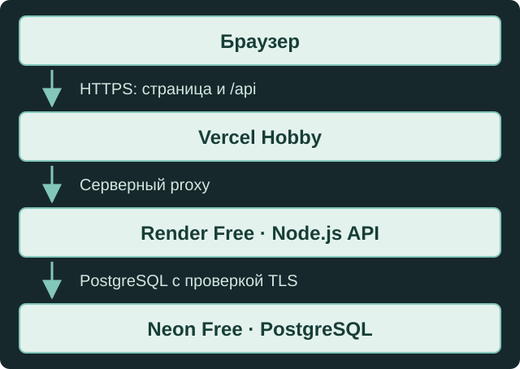

<p align="center"></p>

# ITER Navigator

Учебный навигатор по вымышленному зданию. Он сначала исключает неподходящие проходы, затем ищет кратчайший путь и показывает один результат в тексте, 2D и 3D.

**[Открыть приложение](https://iter-navigator.vercel.app/)** · [Портфолио](https://seoshiro.github.io/)

Здание, размеры, помещения и характеристики проходов придуманы для демонстрации. Приложение не определяет положение человека и не подтверждает доступность реального здания.


## Архитектурный интерфейс

У модели три управляемых состояния: целый корпус, раскрытые этажи и фокус на выбранном помещении. Выбор комнаты выделяет этаж и плавно показывает нужную область. Кнопка «Целое здание» возвращает общий вид. Ручное управление прерывает автоматическую камеру; reduced motion показывает конечное состояние сразу.

2D и 3D построены из общего описания стен и проёмов. Путь проходит через предусмотренные отверстия и следует за этажами. Раскрытие не меняет расстояния маршрута. Неизвестные участки отмечаются пунктиром и знаком вопроса, закрытия — крестом.

На телефоне начальный режим — 2D. Посетитель может включить 3D, и его выбор сохранится. Тяжёлый модуль загружается по выбору; работа с маршрутом не ждёт 3D. Условия, поиск и QR доступны в компактных раскрывающихся панелях. Текущая инструкция находится рядом со схемой или макетом.

У архитектурного макета есть дверные порталы, остекление, лестничные марши, входной навес и настоящие отверстия под лифтовые шахты и лестницы. Последний этаж не содержит лестницы в никуда. Слои здания можно раскрывать и возвращать на место; координаты, свойства проходов и расчёт расстояний от этого не меняются.

На сенсорном экране горизонтальный свайп поворачивает 3D, два пальца меняют масштаб, вертикальный свайп прокручивает страницу. Кнопки ± и сброса находятся рядом с моделью. Явный режим «Жесты камеры» дополнительно захватывает жесты для свободного наклона и смещения; его можно выключить. Масштаб ограничен, браузерный zoom не подменяется масштабом модели.

Фактура светлого камня создана в Higgsfield (GPT Image 2.6) и используется на плитах настоящей Three.js-сцены. Для браузера она уменьшена до 512×512 WebP, около 9 КБ. Это материал, а не сгенерированная геометрия: стены, проёмы, шахты, лестницы и маршруты построены управляемо. При ошибке фактуры сохраняется однотонный материал. [Исходник и журнал операции](docs/assets/higgsfield-iter-ledger.json).

[Проверки архитектурного этапа](docs/architecture-verification.md) и [проверки доработки модели и мобильного 3D](docs/model-refinement-verification.md).
## Что можно делать

- Выбирать **Қазақша / Русский**. Язык сохраняется в браузере; переключение не сбрасывает начало, цель, ограничения, альтернативу и текущий шаг. Казахский интерфейс использует `kk-KZ`.
- Искать помещения по номеру и названию на обоих языках, выбирать их на 2D-схеме или через обычные списки. Карточка помещения позволяет начать маршрут здесь или направиться сюда.
- Исследовать три этажа, два лифта и дополнительные точки: библиотеку, деканат, столовую, медпункт, туалеты и гардероб. Характеристики этих точек также вымышлены.
- Сравнивать основной путь и не более двух содержательно разных альтернатив. Карточки показывают расстояние по графу, лифты, межэтажные переходы и неподтверждённые участки. Нужный обход через лишний этаж не запрещается.
- Проходить маршрут вручную: компактная карта, одна текущая инструкция, прогресс, кнопки назад/дальше и просмотр всех шагов. Местоположение не отслеживается.
- Делиться ссылкой с моделью, стартом, целью и ограничениями. Параметры проверяются; маршрут при открытии рассчитывается заново. Локальные закрытия не передаются.
- Создавать и скачивать три QR-кода стартовых точек: вход, холл второго этажа и библиотека. QR выбирает точку начала, а не включает слежение.
- Настраивать тему, крупный текст, уменьшение движения, вид и камеру. При отказе WebGL остаётся работающая 2D-схема.
- Отправлять вымышленные сообщения в отдельный журнал. Сообщения не изменяют граф, а отказ backend не отключает локальную маршрутизацию.

### Правила маршрутизации

1. Допустимость проходов проверяется **до** поиска пути.
2. Неизвестная характеристика отличается от известного нарушения.
3. Разрешение неполных данных не отменяет известные ограничения. Приложение не ослабляет условия автоматически.
4. Основной путь минимизирует сумму длин рёбер без скрытых штрафов. Отбор разнообразных альтернатив не меняет основной путь.
5. Альтернативы ищутся ограниченным поиском Йена: до 64 кандидатов, затем удаление почти одинаковых и явно проигрывающих вариантов. Для большого графа это не гарантия перечисления всех возможных альтернатив.

Контрольный пример: вход → аудитория 204 даёт **40 м через A**; при закрытии A — **54 м через B**; при закрытии обоих лифтов со строгим запретом лестниц пути нет. Для аудитории 205 строгий режим сообщает о недостаточных данных; разрешение неизвестных данных включается явно. Это расстояния модели, не измерения на местности.

Исходная модель сохранена отдельно в `src/data/building.original.json`. Новые помещения являются ответвлениями и не сокращают контрольные маршруты.

### Голос и доступность

Озвучивание использует только локальные голоса Web Speech API, соответствующие языку интерфейса. Казахский текст не читается русским голосом автоматически. Если подходящего голоса нет, рядом с управлением показано объяснение; текстовый режим остаётся доступен. Платного TTS и доступа к микрофону нет.

Смена языка и устаревание маршрута останавливают речь. После перезагрузки чтение выключено. Скорость и голос сохраняются отдельно для каждого языка. Выбор шага общий для текста, схемы, 3D и озвучивания; это не параллельные системы навигации.

Карта поддерживает клавиатуру, но пользоваться картой необязательно: обычные списки и поиск дают тот же доступ. Изменения объявляются короткими статусами, а не повторным чтением всей страницы.

### Безопасный журнал

Черновик и неподтверждённая попытка сохраняются в `localStorage`. Повтор сохраняет **исходный UUID и payload**; восстановление сети не запускает отправку. Backend уже поддерживает идемпотентность по `clientRequestId`.

При недоступном или повреждённом хранилище отправка блокируется, чтобы не потерять идентичность неподтверждённой попытки. Текст остаётся в открытой вкладке, в том числе при переходе к ручным шагам; сохранение после закрытия вкладки в этом случае невозможно. Неизвестный результат отправки не показывается как успех. Межвкладочные блокировки и проверка идентичности защищают новые черновики от завершения старой попытки.

В публичный журнал следует писать только вымышленные примеры, без персональных данных. Записи видны другим посетителям и не подтверждают состояние здания.

## Стек и структура

- React 19.3, TypeScript, Vite 8.3; Three.js 0.186 для 3D, SVG для 2D.
- Локальная маршрутизация в `src/domain`, данные в `src/data`.
- RU/KK словари и контекст в `src/i18n`; локальная речь в `src/ui/speech.ts`.
- QR создаются в браузере через `qrcode`, без внешнего сервиса.
- Существующий публичный backend: Node.js HTTP, `pg`, PostgreSQL. Vercel проксирует `/api` на Render; данные журнала хранятся в Neon.
- Vitest, Playwright, ESLint и TypeScript для проверок.

### Происхождение исходников

Разработка этого этапа продолжена от актуального публичного коммита `e8151ad`, а не от старого архива. Исторический `deployment-snapshot.json` сопоставлен с полной локальной комплектацией исходной ревизии `9e6693d`: хеши всех перечисленных файлов совпали. Этот файл описывает происхождение прежнего снимка и **не является манифестом текущей сборки**.

В публичный checkout возвращены согласованные frontend-тесты и инструменты разработки. Серверные прокси и работающая схема размещения сохранены. Полная локальная комплектация дополнительно содержит SQLite-инструменты; команды для неё не выдаются здесь за доступные в публичном checkout.

## Локальный запуск

Нужны **Node.js 24.19+ ветки 24** и **pnpm 11.19.0**. Версии зависимостей закреплены.

```sh
pnpm install --frozen-lockfile
pnpm dev
```

Открыть `http://127.0.0.1:5260`. По умолчанию это статический планировщик, без подключения публичного журнала.

```sh
pnpm lint
pnpm typecheck
pnpm test
pnpm build
pnpm preview
```

Собранная версия доступна на `http://127.0.0.1:4273`.

```sh
pnpm exec playwright install chromium
pnpm test:browser
pnpm test:journal
pnpm test:architecture
pnpm test:mobile-3d
```

Основной браузерный набор использует установленный Chrome и порт 5269. Набор журнала использует Playwright Chromium и порт 5264. Оба поднимают Vite самостоятельно; API в локальных тестах замокан, рабочая база не меняется. Проверка масштаба создаёт отдельный временный профиль Chrome и не меняет настройки пользовательского браузера.

## Размещение

Существующая бесплатная схема:



Vercel собирает `dist` при `NAVIGATOR_HOSTED_BUILD=public-demo`. Публичный сервер запускается `pnpm start:public`. Существующие серверные переменные: `NAVIGATOR_PUBLIC_ORIGIN`, `NAVIGATOR_PROXY_SECRET`, `DATABASE_URL`, `NAVIGATOR_DEDICATED_DATABASE`. Секреты не должны попадать в клиент, `VITE_*`, репозиторий или логи. Подробности: [размещение](docs/deployment.md).

Render Free может засыпать. Чтение и повтор отправки выполняются вручную; таймаут журнала не мешает расчёту маршрута.

**Не запускайте PostgreSQL-тесты на рабочей базе.** `pnpm test:postgres` удаляет тестовую схему и допустим только с отдельной синтетической базой `iter_synthetic_*`. Этот этап не требует разрушительных проверок рабочего Neon.

## Проверки и ограничения этапа

Фактический прогон и условия записаны в [отчёте проверок](docs/upgrade-verification.md). Исторические результаты прошлой версии не выдаются за проверки этого этапа.

- Перевод не проверялся носителем казахского языка.
- Мобильные проверки выполняются в браузере на Windows с узкими viewport, не на физическом телефоне. Safari не проверялся.
- Реальное звучание всех локальных голосов и поведение физических экранных дикторов не подтверждены.
- Отказ 3D зависит от браузера/GPU/драйвера; успешный локальный рендер не означает поддержку WebGL в любой среде.
- Выбор помещения непосредственно в 3D не добавлен: доступны 2D, поиск и обычные списки.
- Вымышленная модель и ручное переключение шагов не заменяют обследование здания или реальную навигационную систему.
