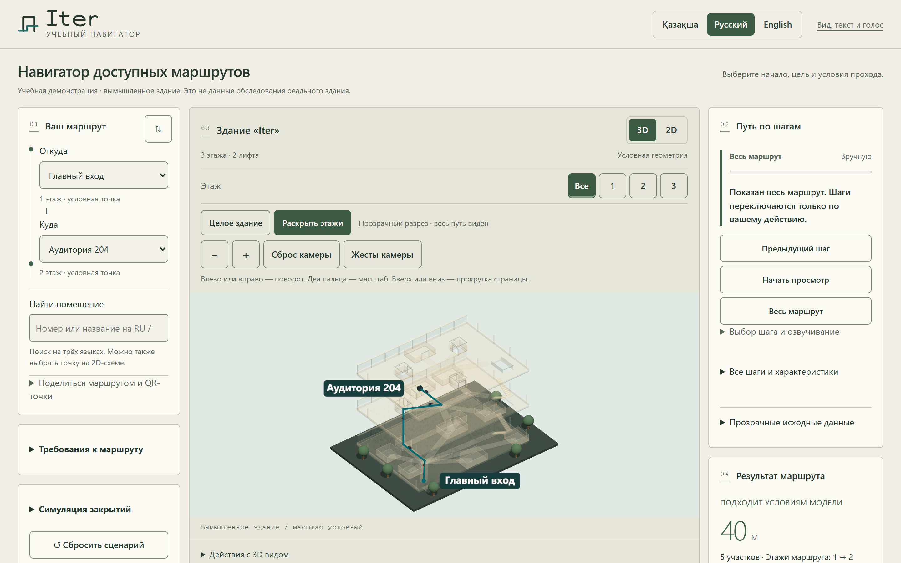
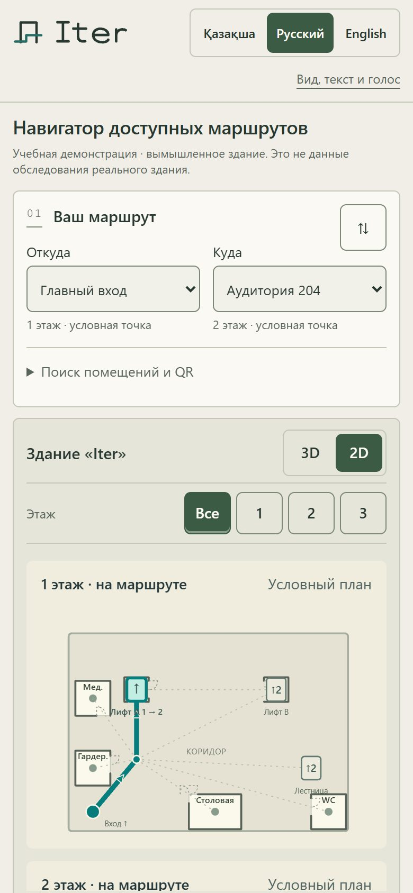
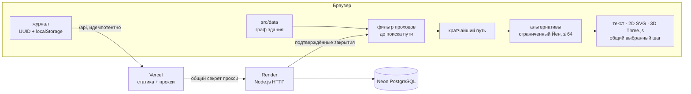
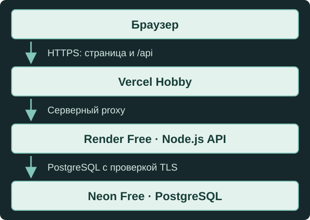

<p align="center"></p>

# ITER Navigator

Навигатор доступных маршрутов по учебному зданию. Пользователь задаёт начало, цель и условия прохода — ширину, уклон, отказ от ступеней. Приложение сначала исключает неподходящие проходы, затем ищет кратчайший путь и показывает его текстом, на 2D-схеме и в 3D-макете.

**[Открыть приложение](https://iter-navigator.vercel.app/)** · [Презентация](https://iter-navigator.vercel.app/presentation) · [Портфолио](https://seoshiro.github.io/)



> Здание, размеры и характеристики проходов вымышлены. Приложение не определяет положение человека и не подтверждает доступность реального здания.

## Проверить за минуту

1. Откройте приложение. По умолчанию выбран маршрут **Главный вход → Аудитория 204**: 40 м через лифт A, этажи 1 → 2.
2. Раскройте «Симуляция закрытий» и закройте **Лифт A**. Маршрут перестроится через лифт B — 54 м.
3. Закройте и **Лифт B**. Пути без лестниц нет, и приложение говорит об этом прямо, не предлагая обход по ступеням.
4. Выберите цель **Аудитория 205**. Ширина её двери неизвестна, поэтому строгий режим не подтверждает путь. Включите «Разрешить участки с неполными данными» — путь в 46 м появится с пометкой «неподтверждённый».
5. Нажмите «Проходить маршрут по шагам» и переключите язык на **Қазақша** или **English**: маршрут и текущий шаг сохранятся.

Это расстояния учебного графа, а не измерения на местности.

## Возможности



- **Три языка** — қазақша, русский, English (`kk-KZ`, `ru-RU`, `en-US`). Переключение не сбрасывает маршрут, условия и текущий шаг.
- **Поиск помещений** по номеру и названию на всех трёх языках, выбор точки на 2D-схеме или в обычном списке.
- **Условия прохода**: минимальная ширина, максимальный уклон, без ступеней, только ровное покрытие, явное разрешение неполных данных. Есть готовые пресеты.
- **Сравнение путей**: основной путь и до двух содержательно разных альтернатив с расстоянием, лифтами и переходами между этажами.
- **Пошаговое прохождение**: одна текущая инструкция, прогресс, кнопки «назад» и «дальше». Местоположение не отслеживается.
- **Ссылки и QR**: ссылка передаёт старт, цель и условия, маршрут при открытии рассчитывается заново. Три QR-кода задают точку старта — вход, холл второго этажа, библиотеку.
- **Журнал препятствий**: посетитель сообщает о сломанном лифте или заблокированном проходе. Непроверенное сообщение показывается как предупреждение и маршрут не меняет.
- **Модерация**: модератор подтверждает поломку, и все пользователи получают обход. После ремонта проход открывается в той же карточке. Закрытие бессрочное или на 1, 8 либо 24 часа.
- **Настройки**: тема, крупный текст, уменьшение движения, озвучивание локальным голосом браузера.

<br clear="right">

## Как строится маршрут

1. Допустимость каждого прохода проверяется **до** поиска пути. Запрещённый участок исключается, а не «штрафуется» в весе.
2. Неизвестная характеристика отличается от известного нарушения: такой участок не запрещён, но и не подтверждён.
3. Разрешение неполных данных не отменяет известные ограничения. Приложение никогда не ослабляет условия само.
4. Основной путь — минимальная сумма длин рёбер, без скрытых штрафов.
5. Альтернативы ищутся ограниченным алгоритмом Йена: до 64 кандидатов, затем почти одинаковые и явно проигрывающие варианты отбрасываются.

Подтверждённые модератором закрытия применяются так же, как условия: проход исключается до поиска. Если на один проход есть несколько жалоб, он остаётся закрытым до снятия последней.

## Архитектура

Маршрут всегда считается в браузере. Сервер нужен только для журнала жалоб и подтверждённых закрытий, поэтому его отказ не ломает навигацию.



### Ключевые решения

**ADR-1. Фильтрация проходов до поиска пути вместо штрафов в весах.** Так приложение не может «тихо» провести человека через запрещённый участок ради выигрыша в метрах. Компромисс: при строгих условиях маршрута может не быть, и это показывается явно.

**ADR-2. Маршрутизация в браузере, сервер — только для журнала.** Маршрут считается сразу, даже если бесплатный Render заснул. Закрытия от модератора проверяются при открытии и каждые 15 секунд. Компромисс: пока проверка не прошла, маршрут показывается с предупреждением, что он может измениться, а пошаговое ведение заблокировано.

**ADR-3. Идемпотентная отправка жалоб.** Черновик и неподтверждённая попытка хранятся в `localStorage` с исходным UUID. Повтор отправляет тот же `clientRequestId`, и сервер не создаёт дубликатов. Восстановление сети само ничего не отправляет. Компромисс: при недоступном хранилище отправка блокируется.

**ADR-4. Одна модель для 2D и 3D.** Стены и проёмы описаны один раз, SVG-схема и Three.js-макет строятся из одних данных. 3D-модуль загружается по выбору, на телефоне по умолчанию открывается 2D. Компромисс: выбрать помещение прямо в 3D нельзя — только через 2D, поиск и списки.

### 3D-макет

У макета три состояния: целое здание, раскрытые этажи и фокус на помещении. Раскрытие не меняет расстояний. У модели есть дверные порталы, остекление, лестничные марши и отверстия под лифтовые шахты. Неизвестные участки показаны пунктиром, закрытые — крестом. Фактура светлого камня сгенерирована для концепта; геометрия, проёмы и маршруты построены из данных модели. Если WebGL недоступен, остаётся рабочая 2D-схема.

### Доступность

- Всё доступно без карты: обычные списки и поиск дают тот же результат, что и схема.
- Клавиатурная навигация с видимым фокусом, изменения объявляются короткими статусами.
- Озвучивание использует только локальные голоса Web Speech API на языке интерфейса; микрофон и платный TTS не используются.
- `prefers-reduced-motion` и настройка «уменьшить движение» сразу показывают конечное состояние камеры.

## Тесты

| Набор | Команда | Что проверяет | Тестов |
| --- | --- | --- | --- |
| Модульные | `pnpm test` | маршрутизация, альтернативы, ссылки, хранилище, i18n, речь | 225 |
| PostgreSQL | `pnpm test:postgres` | транзакции, лимиты, повтор UUID, закрытия | 9 |
| Модерация E2E | `pnpm test:moderation` | телефон модератора и независимые клиенты на реальной БД | 1 |
| Браузер | `pnpm test:browser` | маршрут, языки, поиск, ссылки, QR, WebGL, 375/390 px, zoom 200 % | 10 |
| Журнал | `pnpm test:journal` | черновик, повтор UUID, офлайн, вкладки, проверка ввода | 17 |
| Архитектурный интерфейс | `pnpm test:architecture` | раскрытие этажей, фокус, 3D-сцена | 13 |
| Мобильное 3D | `pnpm test:mobile-3d` | жесты, масштаб, прокрутка | 6 |

Плюс `pnpm lint` и `pnpm typecheck`. Браузерные наборы используют замоканный API и не трогают рабочую базу.

## Стек

- React 19.3, TypeScript, Vite 8.3; Three.js 0.186 для 3D, SVG для 2D.
- Маршрутизация в `src/domain`, данные здания в `src/data`, словари в `src/i18n`, речь в `src/ui/speech.ts`.
- QR создаются в браузере библиотекой `qrcode`.
- Сервер: Node.js HTTP и `pg` (`server/`), общий контракт API в `shared/`.
- Vitest, Playwright, ESLint.

## Локальный запуск

Нужны **Node.js 24.19+** (ветка 24) и **pnpm 11.19.0**.

```sh
pnpm install --frozen-lockfile
pnpm dev            # http://127.0.0.1:5260 — планировщик без журнала
```

```sh
pnpm lint && pnpm typecheck && pnpm test
pnpm build && pnpm preview   # http://127.0.0.1:4273
```

Браузерные тесты: `pnpm exec playwright install chromium`, затем команды из таблицы выше. Основной набор использует установленный Chrome.

**Журнал и модерация локально.** Соберите `pnpm build`, укажите `NAVIGATOR_LOCAL_DATABASE_URL` — отдельную пустую базу PostgreSQL на loopback с именем `iter_local_*` — и серверный `NAVIGATOR_MODERATOR_SECRET`, затем `pnpm start:local` и откройте `http://127.0.0.1:4280`. Панель модерации — «Проверка жалоб» под журналом.

**Тесты с PostgreSQL** (`test:postgres`, `test:moderation`) запускаются только на отдельной пустой базе `iter_synthetic_*`: задайте `NAVIGATOR_PG_TEST_LOCAL=1` и `NAVIGATOR_PG_TEST_URL`. `test:postgres` удаляет тестовую схему — **не запускайте эти наборы на рабочей базе**.

## Размещение



Vercel собирает `dist` при `NAVIGATOR_HOSTED_BUILD=public-demo` и проксирует `/api` на Render; данные журнала хранятся в Neon. Сервер запускается `pnpm start:public` с переменными `NAVIGATOR_PUBLIC_ORIGIN`, `NAVIGATOR_PROXY_SECRET`, `DATABASE_URL`, `NAVIGATOR_DEDICATED_DATABASE`. Секреты не попадают в клиент и репозиторий. Подробности — в [docs/deployment.md](docs/deployment.md).

Бесплатный Render засыпает после простоя, и первые запросы к журналу могут занять около минуты. Маршрут в это время уже виден, но с пометкой, что закрытия ещё не проверены; пошаговое ведение включается после проверки.

## Ограничения

- Здание и все его характеристики вымышлены; модель не заменяет обследование и реальную навигационную систему.
- Казахский перевод не проверялся носителем языка. Презентация доступна на RU и KK.
- Мобильная версия проверялась в эмуляции Chrome, не на физическом телефоне; Safari не проверялся.
- Звучание локальных голосов и работа экранных дикторов зависят от устройства и не подтверждены.
- Поддержка WebGL зависит от браузера и видеокарты; при отказе работает 2D.
